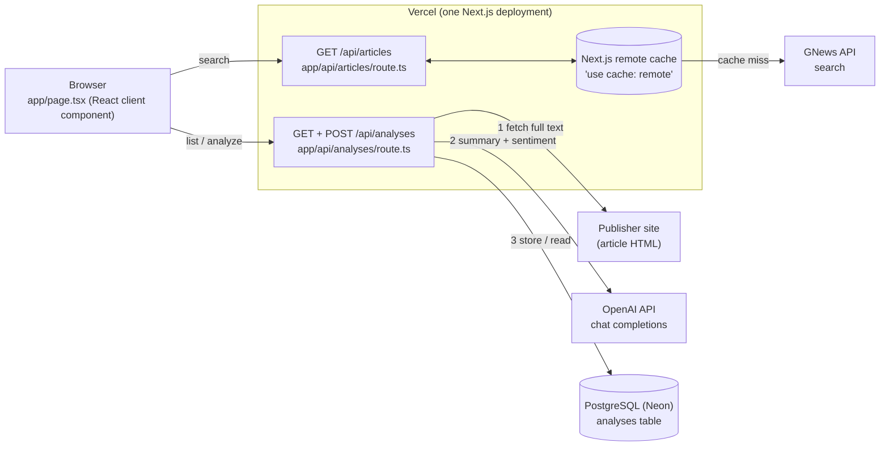
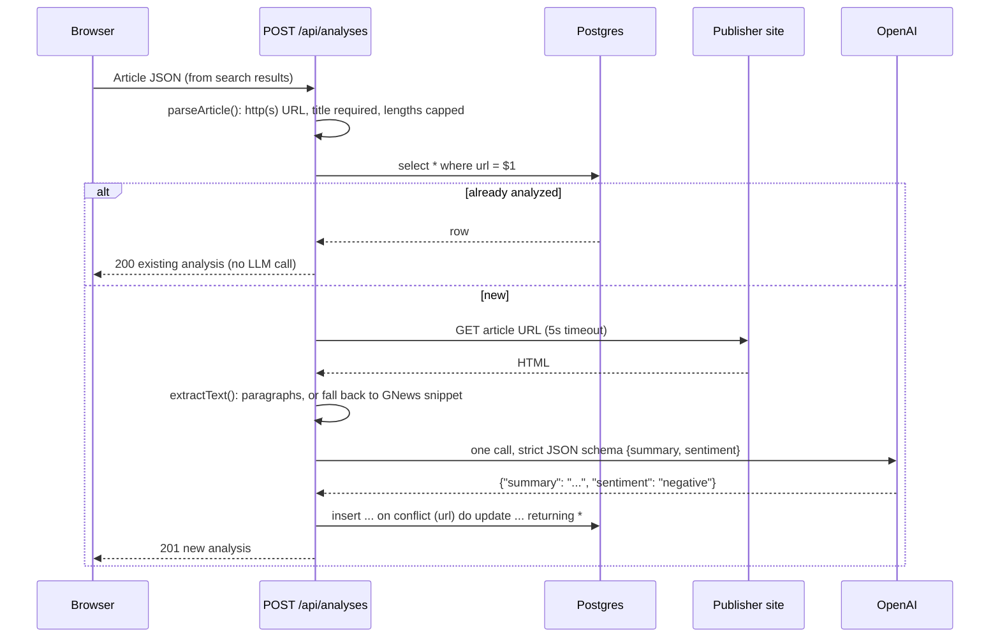

# Architecture

Newsbrief is one Next.js app: a single page plus a three-endpoint REST API, backed by one Postgres table. This document covers how the pieces fit, how each request flows, and every design decision, with the options I considered and why I picked the one I did.

- [1. System overview](#1-system-overview)
- [2. Code map](#2-code-map)
- [3. Request flows](#3-request-flows)
- [4. Data model](#4-data-model)
- [5. Product & UX design](#5-product--ux-design)
- [6. Decisions and trade-offs](#6-decisions-and-trade-offs)
- [7. Security](#7-security)
- [8. Known limits and upgrade paths](#8-known-limits-and-upgrade-paths)
- [9. Testing](#9-testing)

## 1. System overview



The browser only ever talks to our own API. API keys (GNews, OpenAI) and the database credentials stay server-side in Vercel environment variables.

## 2. Code map

| File | Role |
| --- | --- |
| `app/page.tsx` | Page state and layout: search, per-article analyze and "Analyze all", the library with filters. Client component with plain `useState`. |
| `app/components.tsx` | Presentational pieces: article card (with inline analysis), library card, mood bar, badge, skeletons, relative time. |
| `app/globals.css` | Semantic color tokens (`bg-surface`, `text-muted`, `bg-pos`…) with dark-mode values. |
| `app/api/articles/route.ts` | `GET /api/articles?q=`: validates the query, calls GNews (cached), normalizes the response into our `Article` shape. |
| `app/api/analyses/route.ts` | `GET /api/analyses` lists rows. `POST /api/analyses` validates the article, dedupes by URL, fetches the full text, calls OpenAI, inserts. |
| `lib/article.ts` | Shared types (`Article`, `Analysis`, `Sentiment`) used by both the API and the UI, plus three pure functions: `parseArticle` (input validation), `toGNewsQuery` (query escaping), `extractText` (HTML → article text). |
| `lib/article.test.ts` | Unit tests for those three functions (`node:test`, no framework). |
| `schema.sql` | The single table, run once with `psql`. |

That's the whole application. There's no service layer, repository layer or state library, because none of them would have a second user.

## 3. Request flows

### 3.1 Search: `GET /api/articles?q=…`

1. Reject empty queries and queries over 200 characters (GNews' limit) with `400`.
2. `toGNewsQuery` quotes words containing special characters (`covid-19` becomes `"covid-19"`). GNews returns a syntax error for those otherwise, and people type them all the time. Operators the user typed (`AND`, `OR`, `NOT`, quotes, parentheses) pass through unchanged.
3. `search()` is marked `'use cache: remote'`. An identical query within 15 minutes is served from Vercel's shared cache and doesn't spend any of the 100 requests/day.
4. On success: map GNews' shape (`image`, `source.name`) to ours (`imageUrl`, `source`) and return `200 {articles}`.
5. On failure: GNews' own message ("You have reached your request limit for today…", "Invalid API Key provided.") goes back as `502 {error}`. Failures are cached for under a minute only. They're returned as values, not thrown, because Next.js replaces thrown error messages with a generic text in production builds, and the user should know *why* search failed.

### 3.2 Analyze: `POST /api/analyses`



Details worth knowing:

- **Why fetch the page at all?** On the free tier, GNews' `content` is cut off after ~200 characters (`"... [1862 chars]"`). Summarizing that is little more than restating the description. Fetching the page gives the model the whole story: in testing, a BBC article went from ~200 to 7,879 characters of input. If the site blocks us, times out, paywalls the text or renders it with JavaScript, we fall back to title + description + snippet. The prompt then tells the model to summarize only what's there and not invent details.
- **One LLM call, two outputs.** Summary and sentiment come back from a single request with OpenAI Structured Outputs (`response_format: json_schema`, `strict: true`). The enum is `positive | neutral | negative`, so the model can't return anything else. The database `CHECK` constraint is a second guard.
- **Idempotent by URL.** The URL is the natural key. A repeat request returns the stored row with `200` instead of `201`. If two requests race, `on conflict … do update set url = excluded.url returning *` is a no-op update that still returns the winner's row, so neither request errors.
- **Failures don't write.** If the LLM call fails, nothing is inserted. The client gets `502 {error: "Analysis failed, try again"}` and the cause goes to the server log.

### 3.3 List: `GET /api/analyses`

`select * from analyses order by created_at desc`. `await connection()` marks the handler as request-time, so Next.js doesn't try to prerender it during the build. postgres.js' `camel` transform maps `image_url` to `imageUrl` in both directions, so rows go straight into JSON.

## 4. Data model

```sql
create table analyses (
  id int generated always as identity primary key,
  url text not null unique,         -- natural key, makes POST idempotent
  title text not null,
  description text,
  source text,
  image_url text,
  published_at timestamptz,
  summary text not null,
  sentiment text not null check (sentiment in ('positive', 'neutral', 'negative')),
  created_at timestamptz not null default now()
);
```

- **One table.** An article and its analysis are 1:1, so they live in one row. See decision 6.3.
- **Article metadata is a snapshot** taken when it was analyzed (title, source, image), so the list renders without calling GNews again. That matters because GNews only keeps 30 days of history.
- **The extracted article body is not stored.** It's only an input to the LLM, and storing scraped full text adds copyright questions and storage for no feature.
- `int` rather than `bigint` for the id because postgres.js returns `bigint` as a string. `int` covers 2 billion rows.
- The `unique` constraint on `url` also gives us the index the dedupe lookup uses.

## 5. Product & UX design

The brief leaves "how the user selects an article" open. The design goal was: **analysis is something you ask for, its result appears where you asked, and it's never wasted or repeated.** The page answers two questions: *what's this story about?* (summary) and *how does the news on this topic feel?* (tone across results).

**Getting started**
- **First visit:** a "how it works" strip (search, then pick, then get the gist) plus one-click **topic chips** (AI, Climate, Markets…). There's no blank page to stare at, and no headlines load on their own, which would spend a GNews request on every page view.
- **Search** has a large input, a `/` shortcut to focus it, and skeleton cards while loading. The query is written to the URL (`?q=climate`), so refreshing or sharing the link keeps the search. Responses to a search you've already replaced are ignored, so a slow earlier request can't overwrite a newer one.

**Choosing what to analyze.** I considered four options:
1. Auto-analyze every result: 10 LLM calls and ~10 page fetches per search, mostly for articles you'll skim past. That's slow, costs money, and fills the library with noise.
2. Analyze when you open an article: clicking a headline is also how you read the source, so the two intents collide.
3. **A "Summarize & score" button on each article** (chosen).
4. **An "Analyze all N" button for the current results** (chosen, alongside 3). It's opt-in, so it isn't option 1. It runs 3 at a time with a live "Analyzing… 5 left" count. This is how you get a topic's overall tone in one click.

**Seeing the result**
- **The analysis appears inside the card you clicked:** a sentiment badge plus the summary, with a sentiment-colored accent. While it runs, a skeleton says "Reading the article and analyzing…", which is honest about the two steps. Errors appear on that card with a **Try again** button.
- **Topic tone bar:** once any result is analyzed, a stacked bar above the results shows the mix ("Tone of 'Climate' · 6 of 6 analyzed: 3 positive, 0 neutral, 3 negative").
- **Already-analyzed results show their analysis straight away**, with no button and no second LLM call. Repeats are visible instead of being silently skipped.

**The library** (everything saved, newest first)
- On desktop it's a sticky sidebar, so it stays in view while you scroll results. On phones it stacks below the results, or above them when you haven't searched yet, so returning users see their library first.
- It has an overall tone bar, sentiment filter chips, and a keyword filter over title, summary and source.
- A "How is sentiment scored?" disclosure (native `<details>`) gives the definitions below, so the labels can be explained.

**Craft**
- Semantic color tokens with a real dark mode (it follows the OS setting).
- Geist font and relative times ("3 hours ago", with the exact time on hover).
- Broken thumbnails hide themselves.

**Accessibility**
- Every control has a label. Errors use `role="alert"`. Result counts are announced through a polite live region. Filter chips use `aria-pressed`. Loading regions are `aria-busy`.
- **Sentiment never relies on color alone.** The green/red pair falls in the colorblind "warning" band of the dataviz palette check (ΔE 6.5–6.9), so every badge and legend carries a shape (▲ ● ▼) and a text label, and bar segments have 2px gaps.

**Every state has a design:** first visit, searching, no results, analyzing, analysis failed, library empty, no filter matches, quota reached.

**Defining "sentiment" for news.** "Sentiment" is ambiguous for journalism: is a neutral report on a disaster negative? The prompt defines it as *the overall tone of the news for a general reader*:

- **positive:** good news, progress, optimism
- **negative:** harm, conflict, loss, criticism
- **neutral:** factual, routine or mixed

Writing it down makes the labels consistent and explainable.

## 6. Decisions and trade-offs

Each entry lists the options I considered, what I chose, and why.

### 6.1 Framework: Next.js (TypeScript) full-stack

| Option | For | Against |
| --- | --- | --- |
| **Next.js, App Router, route handlers** ✅ | One language and one deploy for UI and API. It's Vercel's native framework (zero config). Types are shared between API and UI. `next dev` works without a Vercel login. | A bigger framework than a three-endpoint API strictly needs. |
| FastAPI (Python) + React SPA | Python is fine for API work. | Two runtimes, two build configs and two dependency trees on Vercel. Request/response types are duplicated across languages. |
| Static HTML + plain Vercel functions | Fewest dependencies. | Hand-written DOM state for loading, error and dedupe states gets messy. Local dev needs `vercel dev` and a login. |

The brief allows Python or TypeScript. Using one language end to end removed a whole class of glue code, the shared `Article`/`Analysis` types in particular.

### 6.2 Database access: postgres.js, no ORM

| Option | Why not / why |
| --- | --- |
| **`postgres` (postgres.js)** ✅ | One small dependency. Tagged-template queries are parameterized, so they're safe from SQL injection. Works against any Postgres, local or Neon. The `camel` transform removes the mapping code. |
| Prisma / Drizzle | Schema DSL, migrations tooling and codegen for a single table. Worth it at 5+ tables or once several people change the schema. |
| `@neondatabase/serverless` (HTTP driver) | Great on serverless, but it only talks to Neon, so local development would need Neon too. |

### 6.3 Schema: one table instead of `articles` + `analyses`

The relationship is 1:1, and the product never re-analyzes an article, so a second table would only add a join. **Upgrade path:** split it when one article can have several analyses, for example re-running with a newer model or prompt and keeping history.

### 6.4 Migrations: `schema.sql`, run once

| Option | Notes |
| --- | --- |
| **Plain `schema.sql` + `psql`** ✅ | Readable, one command, and the schema is documentation too. |
| A migration tool (node-pg-migrate, Prisma Migrate) | Worth adding with the second schema change. |
| `create table if not exists` on every cold start | No setup step, but DDL ends up in the request path and the schema is hidden in code. |

### 6.5 One structured-output LLM call, raw `fetch`

- **One call vs two** (one summary call, one sentiment call): one call halves cost and latency, and both outputs see the same context.
- **Structured Outputs vs "reply in JSON" prompting:** strict JSON schema means the response always parses and the sentiment enum can't drift ("Positive.", "mixed").
- **`fetch` vs the `openai` SDK:** one endpoint is about 20 lines of `fetch`. The SDK is worth adding for streaming, retries or a second endpoint.
- **Model in `OPENAI_MODEL` (default `gpt-4.1-nano`):** the brief specified `gpt-4.1-nano`, and OpenAI has since retired it (the API returns `404 model deprecated`). The model is the value most likely to change over the app's life, so it's an environment variable, not a constant. No `temperature` is set, because newer reasoning models reject non-default values; the strict schema plus a written definition of sentiment keeps the output stable.

### 6.6 Getting the article text: fetch page, extract `<p>`, fall back

| Option | Notes |
| --- | --- |
| Snippet only | Zero work, but the "summary" is basically the description. Fails "useful, not arbitrary". |
| GNews paid plan (full `content`) | Cleanest, but costs money. |
| `@mozilla/readability` + `jsdom` | Best extraction quality, but jsdom is a heavy dependency for a serverless function. |
| **Regex paragraph extraction + snippet fallback** ✅ | About 15 lines, unit-tested, and works on most news sites. Marked in code with a `ponytail:` comment naming Readability as the upgrade. |

### 6.7 Caching GNews: `'use cache: remote'`

The free tier is 100 requests/day at 1 request/second. Plain `'use cache'` is in-memory, and Vercel serverless instances don't share memory, so on Vercel it would rarely hit. `'use cache: remote'` uses Vercel's shared cache handler. Fresh for 15 minutes, gone after an hour: GNews' free tier already has a 12-hour delay, so 15 minutes of staleness costs nothing. Failures get the `seconds` profile, so a quota or outage message clears within about a minute.

### 6.8 API shape

- **Two resources.** `articles` is external, search-only. `analyses` is ours, with list and create. Nouns, plural, HTTP verbs, no RPC-style `/analyze` endpoint.
- **POST takes the whole article** (the client already has it from search). Alternatives:
  - POST only `{url}` and look the article up on the server: GNews can't look up by URL.
  - Keep search results in a server-side session: needs state and auth for no user benefit.

  The cost is that metadata comes from the client, so it's validated at the boundary. See §7.
- **Status codes carry meaning:** `201` created vs `200` already existed, `400` for bad input, `502` when an upstream service (GNews, OpenAI) failed. Every error body is `{error}`, so the UI handles all failures with one helper.
- **No pagination yet:** see §8.

### 6.9 Frontend: one page, Tailwind tokens, no extra libraries

- **State:** no React Query, Redux or UI kit. A handful of `useState`s and one 6-line `api()` helper cover it.
  - A `Set` of pending URLs drives every loading state, whether it came from a card click or "Analyze all".
  - An in-flight ref inside `analyze()` stops the two paths from sending the same article twice. The guard sits in the one function both paths call.
- **"Analyze all"** is three async workers draining a shared queue: about 6 lines, no p-limit dependency. A concurrency of 3 keeps it fast without hammering publishers or OpenAI.
- **Styling:** Tailwind (from the scaffold) with **semantic tokens** in `globals.css` (`surface`, `line`, `muted`, `pos`/`neu`/`neg`). Components never say `dark:`. Dark mode swaps token values in one media query.
- **Dataviz:** the tone bar is a CSS flex row (`flex-grow` = count, 2px gap). No chart library for three segments.
- **Native features first:**
  - `Intl.RelativeTimeFormat` for "3 hours ago"
  - `<details>` for the sentiment explainer
  - `type="search"` for the clear button
  - `history.replaceState` for shareable URLs
  - Plain `` for thumbnails, because `next/image` needs every remote host allowlisted and news images come from hundreds of CDNs.
- **No hydration mismatches:** dates render only for data fetched client-side.

### 6.10 Hosting: Vercel + Neon

Vercel was required. Neon is Vercel's Marketplace Postgres (Vercel Postgres moved to Neon). It sets `DATABASE_URL` automatically, has a free tier, and pools connections for serverless.

**Region co-location.** The functions and the database both run in `iad1`. A request to `POST /api/analyses` makes two database round trips, so the function belongs next to the database, not next to the user: a user far away pays the distance once per request instead of once per query. The project defaulted to `lhr1` and was changed to match the database.

## 7. Security

- **Secrets are server-side only.** The GNews and OpenAI keys are read from `process.env` in route handlers and never reach the browser. `.env*` is gitignored except `.env.example`.
- **SQL injection:** every query is a postgres.js tagged template, so values are always sent as parameters.
- **Validation at the trust boundary.** `parseArticle` requires an `http(s)` URL and a title, trims and caps every string, drops unknown fields, requires a parseable `publishedAt`, and only accepts `http(s)` image URLs, which blocks `javascript:` and `data:` URLs from reaching `` or `<a href>`. React escapes all rendered text.
- **Server-side fetch of a client-supplied URL (SSRF).** Only `http(s)`, a 5s timeout, and the response is only parsed as text. That's acceptable on Vercel, which has no private network to reach. Self-hosting on a private network would need a host allowlist (marked `ponytail:` in code).
- **Cost abuse (no auth, no rate limit).** The brief has no user accounts, so anyone with the URL can trigger LLM calls. The URL dedupe limits repeats. **Upgrade:** a Vercel Firewall rate-limit rule on `POST /api/analyses` (no code), or auth.
- External links open with `rel="noreferrer"`.

## 8. Known limits and upgrade paths

| Limit | When it matters | Upgrade |
| --- | --- | --- |
| `GET /api/analyses` returns every row | A few hundred analyses | `limit` + cursor on `(created_at, id)` |
| Regex text extraction | Sites with unusual markup | `@mozilla/readability` |
| GNews free tier: 12h delay, 10 results, 100 requests/day | Real-time news, heavy use | Paid plan; only the URL/params change |
| No auth / rate limit | Public traffic | Vercel Firewall rule; auth if analyses become per-user |
| One analysis per article | Comparing models/prompts, refreshing old ones | `articles` + `analyses` tables, "re-analyze" action |
| Exact-URL dedupe | Same story behind tracking params (`?utm_…`) | Normalize the URL (strip `utm_*`) before lookup |

## 9. Testing

- `npm test` runs `node:test` against the three pure functions holding the non-trivial logic: query escaping, input validation (including `javascript:` URLs and bad dates), and HTML extraction (scripts, nav crumbs, entities, whitespace). No test framework: Node runs `.ts` directly.
- `npm run build` type-checks everything. `npm run lint` runs ESLint.
- End to end, verified against a production build with a real Postgres and real article fetching:
  - search
  - quota-error passthrough
  - cache hit on a repeated query
  - analyze → `201`, same article again → `200` with no second LLM call
  - invalid input → `400`
  - LLM failure → `502` with nothing written
  - UI flow in headless Chrome at desktop and phone width, light and dark:
    - topic chip search with skeletons, and `?q=` surviving a reload
    - `/` shortcut
    - inline analysis, plus "Analyze all" running 3 at a time with a live count
    - topic tone bar
    - each sentiment filter showing only matching cards, and the keyword filter's no-match state
    - no horizontal overflow, no console errors
